# Hotel Booking Cancellation Prediction

A university Data Science project that investigates why hotel bookings get canceled and tests 6 machine learning algorithms to predict cancellations before they happen.

---

## 1. What is this Project About?

Hotels lose significant revenue when guests book rooms and cancel at the last minute. The goal of this project is to:
1. Understand which factors are most connected to booking cancellations (e.g., lead time, deposit type, country).
2. Train and compare 6 different Machine Learning algorithms to see which one predicts cancellations best.
3. Test if tuning hyperparameters actually improves model performance across all evaluation metrics.
4. Check if feature selection or PCA (dimensionality reduction) helps or hurts model accuracy.

### The Dataset
- **Source**: Kaggle Hotel Booking Demand Dataset (Jessemostipak)
- **Size**: 119,390 bookings (from City and Resort hotels in Portugal)
- **Target Variable**: `is_canceled` (0 = Did not cancel, 1 = Canceled)

---

## 2. Project Folder Structure

The project is organized simply:

```text
hotel-booking-cancellation-prediction/
├── data/
│   ├── raw/                 # Original hotel_bookings.csv dataset
│   └── processed/           # Cleaned 80/20 train and test parquet/csv files
├── models/                  # All saved .joblib models (default + tuned + preprocessor)
├── notebooks/               # 10 step-by-step Jupyter notebooks
├── report/                  # Full academic research paper and presentation slides
├── results/                 # Dedicated folders for every notebook's plots and tables
│   ├── 01_data_exploration/
│   ├── 02_data_preprocessing/
│   ├── 03_knn/
│   ├── 04_decision_tree/
│   ├── 05_random_forest/
│   ├── 06_xgboost/
│   ├── 07_lightgbm/
│   ├── 08_mlp/
│   ├── 09_feature_selection_and_pca/
│   └── 10_model_comparison/
├── src/                     # Helper functions for data loading, preprocessing, evaluation, and plotting
├── README.md                # Project guide with all results, metrics, and visual plots
└── requirements.txt         # Required Python packages
```

---

## 3. Step-by-Step Workflow & Results

### Step 1: Data Exploration (`01_data_exploration.ipynb`)
We first inspected the raw dataset, checked for missing values, and visualized cancellation rates across different booking features.

- **Class Balance**: 37.0% of bookings were canceled and 63.0% were not canceled.
- **Key Pattern**: Bookings made far in advance (`lead_time`) and bookings with a `Non Refund` deposit had much higher cancellation rates.

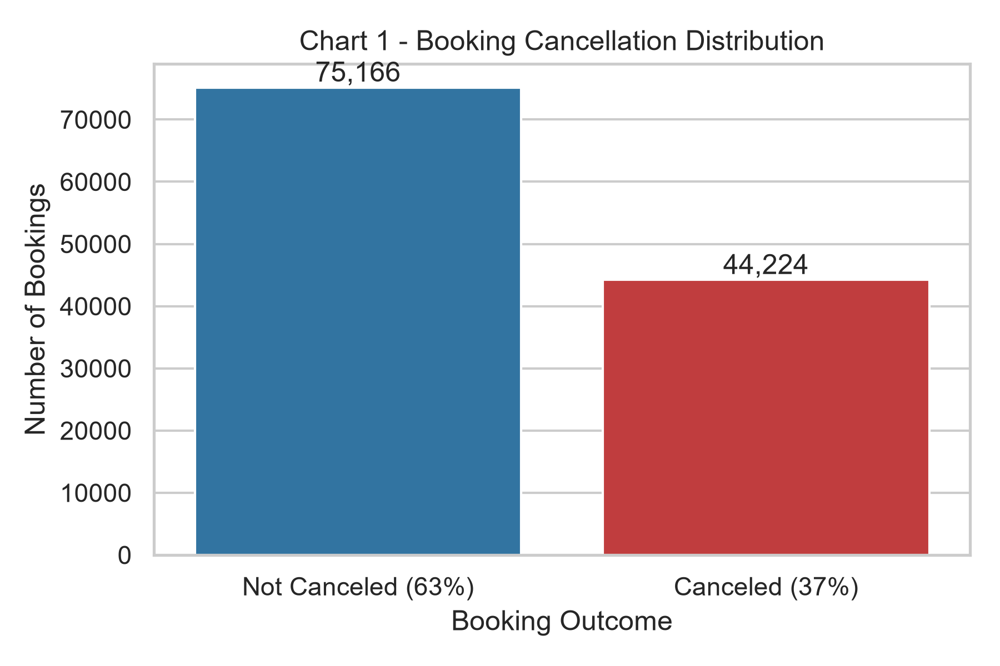
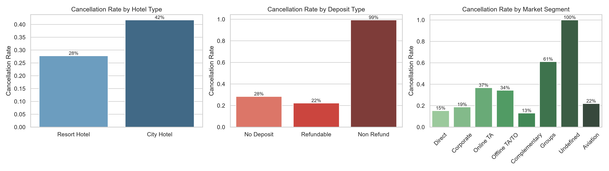

---

### Step 2: Data Preprocessing & Cleaning (`02_data_preprocessing.ipynb`)
Real data contains noise and potential data leaks. We cleaned the data using standard steps:
1. **Removed Ghost Bookings**: Dropped 180 rows where adults, children, and babies were all 0.
2. **Fixed Price Outliers**: Removed 2 invalid rows (one negative room rate and one typo of 5,400 EUR).
3. **Prevented Data Leakage**: Dropped `reservation_status` and `reservation_status_date` because knowing a guest "checked out" directly reveals they did not cancel.
4. **Engineered 5 Useful Features**: Total stay nights, total guests, booking changes made, kids present indicator, and parking requested indicator.
5. **Stratified Split**: 80% for training ($N = 95,366$) and 20% for testing ($N = 23,842$).
6. **Encoding & Scaling**: Scaled numerical features with `StandardScaler` and one-hot encoded categories, giving 255 predictor columns.

---

### Step 3: Model Evaluation & Metric Analysis (Notebooks 03 to 08)

For each model, we evaluated all key classification metrics:
- **Accuracy**: Overall fraction of correct predictions.
- **ROC-AUC**: Ability to rank cancellations above non-cancellations regardless of threshold.
- **F1-Score**: Harmonic mean of Precision and Recall.
- **Precision**: When predicting a cancellation, how often the model is correct (minimizes false alarms).
- **Recall**: Percentage of actual cancellations detected (minimizes missed cancellations).
- **Specificity**: Percentage of non-cancellations correctly identified.

---

#### 1. K-Nearest Neighbors (KNN) (`03_knn.ipynb`)
- **Default**: $k = 5$, uniform weights.
- **Tuned**: $k = 15$, distance-based weights (closer neighbors have more say).
- **Takeaway**: Distance weighting improved F1-score (+3.1%) and Accuracy (+2.4%) because it prevents distant noisy neighbors in high dimensions from diluting the vote.

| Metric | Default (No Tuning) | Tuned | Improvement |
| :--- | :---: | :---: | :---: |
| **Accuracy** | 83.61% | **86.05%** | +2.44% |
| **ROC-AUC** | 0.8998 | **0.9309** | +0.0311 |
| **F1-Score** | 0.7738 | **0.8047** | +0.0310 |
| **Precision** | 79.23% | **83.65%** | +4.41% |
| **Recall** | 75.61% | **77.53%** | +1.92% |
| **Specificity** | 88.32% | **91.07%** | +2.75% |

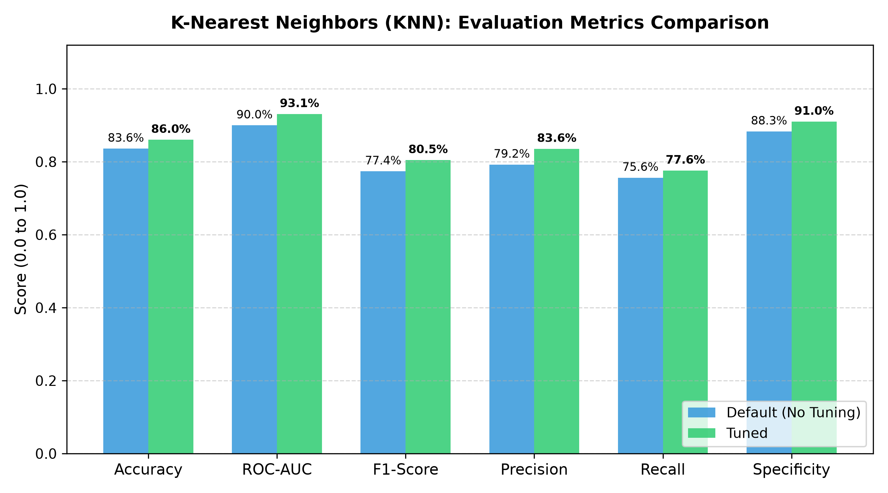
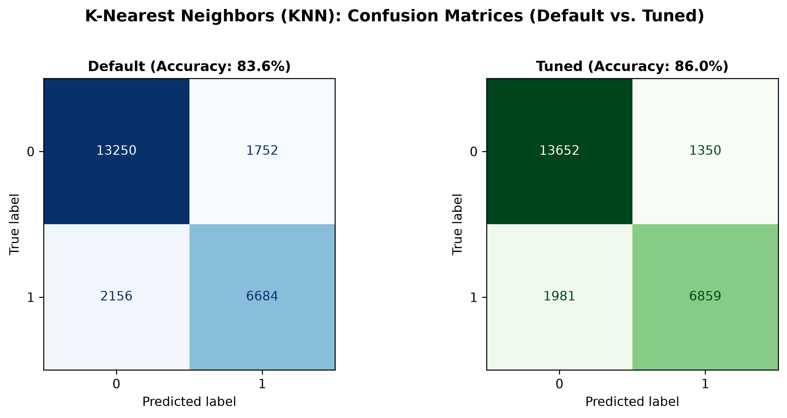
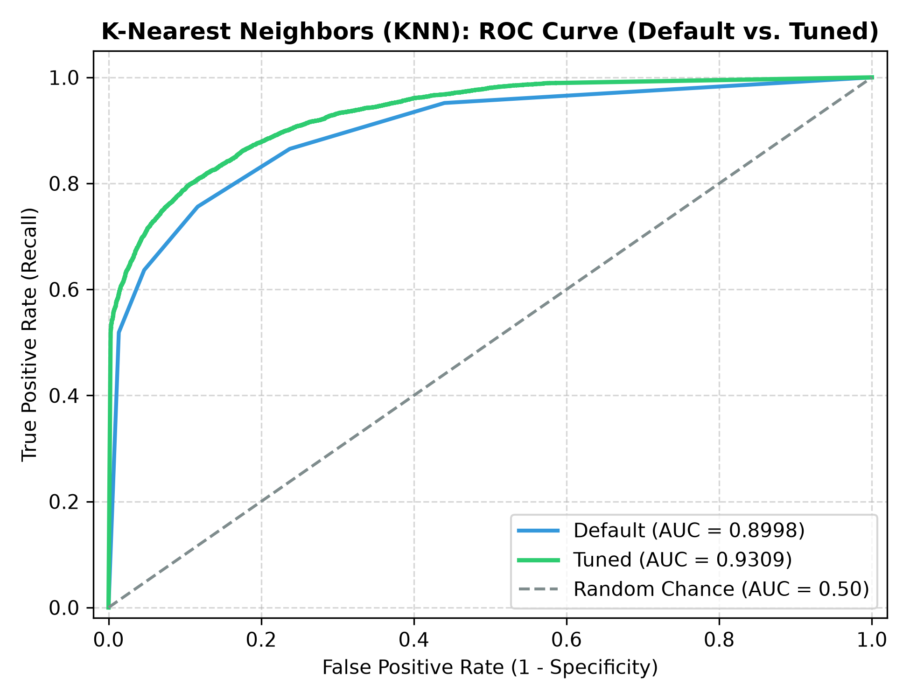
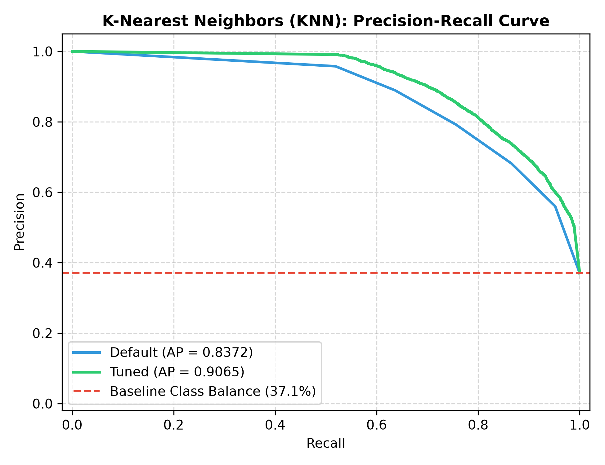

---

#### 2. Decision Tree (`04_decision_tree.ipynb`)
- **Default**: Unconstrained tree (`max_depth = None`).
- **Tuned**: Regularized tree (`max_depth = 15`, `min_samples_leaf = 10`, `criterion = entropy`).
- **Takeaway**: An unpruned tree severely overfits training noise. Regularizing depth boosted ROC-AUC from 0.8597 to **0.9387** (+7.9%) and raised Precision from 81.49% to **84.55%**.

| Metric | Default (No Tuning) | Tuned | Improvement |
| :--- | :---: | :---: | :---: |
| **Accuracy** | 86.59% | **86.80%** | +0.21% |
| **ROC-AUC** | 0.8597 | **0.9387** | +0.0790 |
| **F1-Score** | 0.8204 | **0.8157** | -0.46% |
| **Precision** | 81.49% | **84.55%** | +3.06% |
| **Recall** | 82.59% | **78.80%** | -3.79% |
| **Specificity** | 88.95% | **91.51%** | +2.57% |

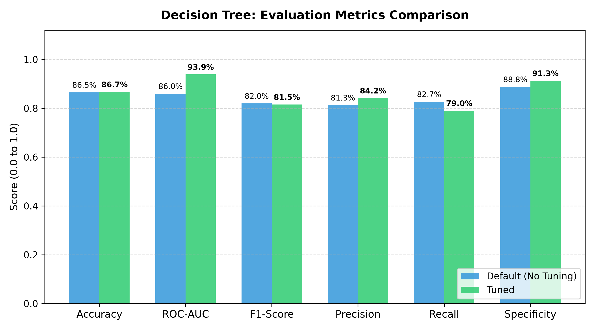
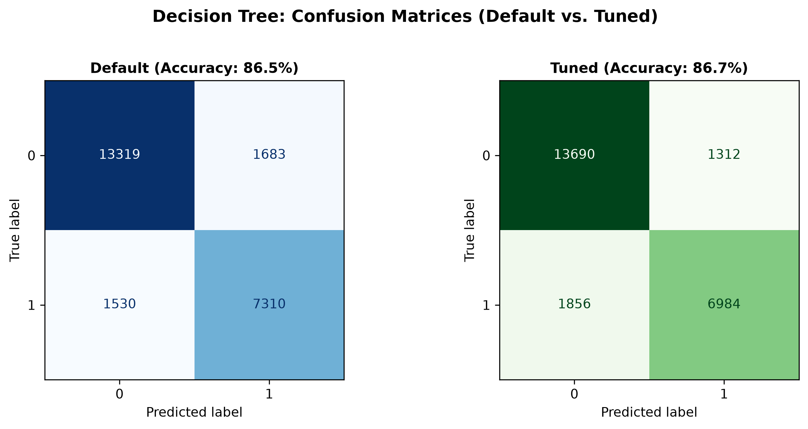
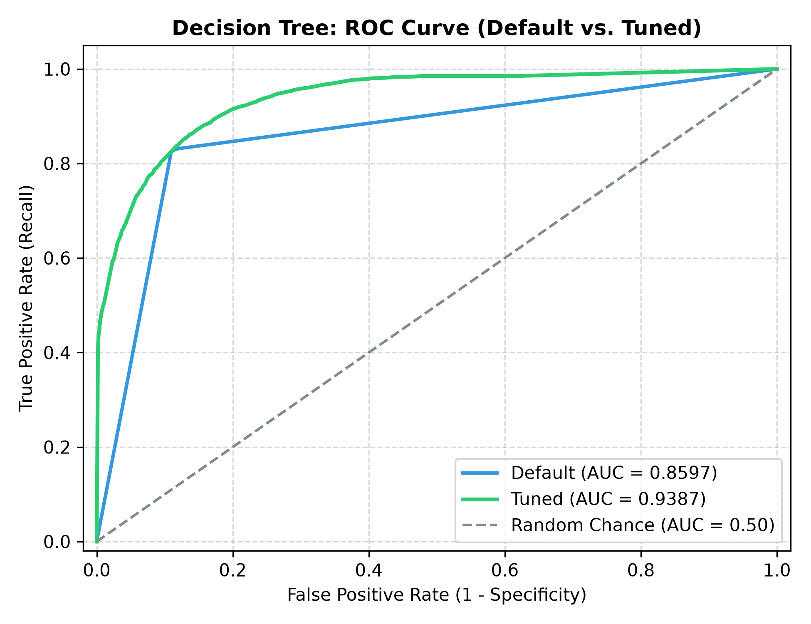
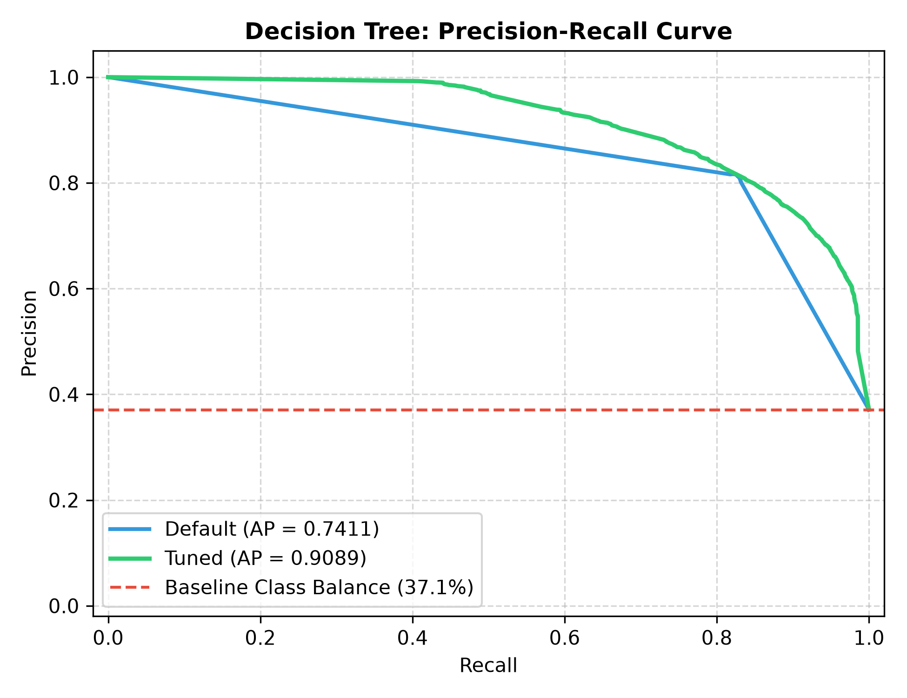

---

#### 3. Random Forest (`05_random_forest.ipynb`)
- **Default**: 100 trees, default split criteria.
- **Tuned**: 200 trees, `max_depth = 25`, `min_samples_split = 5`.
- **Takeaway**: Top-tier performance across the board. Random Forest delivers the **highest Precision (89.52%)** and **highest Specificity (94.43%)** of all models, meaning when it flags a cancellation, hotel staff can be 90% sure it is accurate.

| Metric | Default (No Tuning) | Tuned | Improvement |
| :--- | :---: | :---: | :---: |
| **Accuracy** | 89.16% | **89.33%** | +0.17% |
| **ROC-AUC** | 0.9590 | **0.9594** | +0.0005 |
| **F1-Score** | 0.8459 | **0.8486** | +0.26% |
| **Precision** | 89.40% | **89.52%** | +0.11% |
| **Recall** | 80.27% | **80.66%** | +0.38% |
| **Specificity** | 94.39% | **94.43%** | +0.04% |

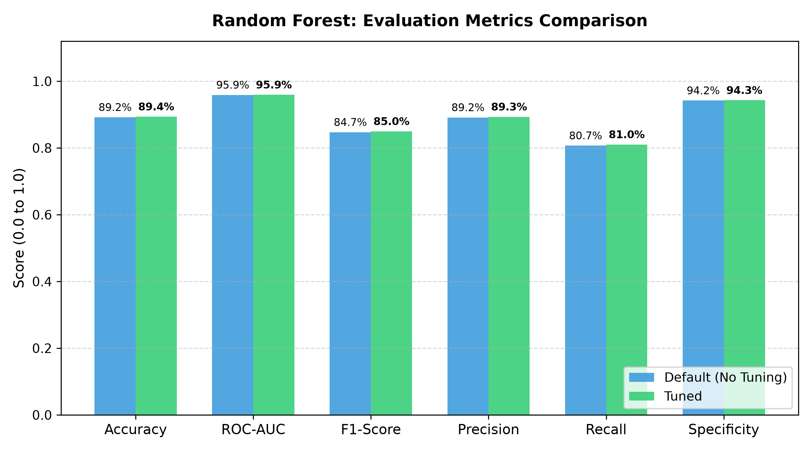

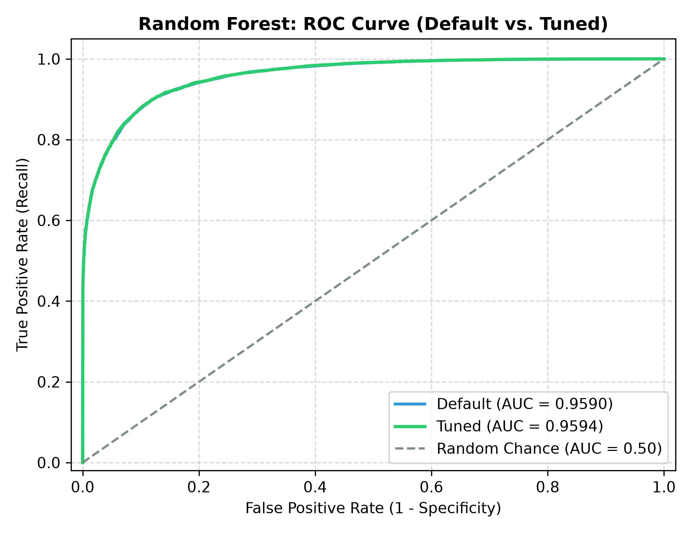
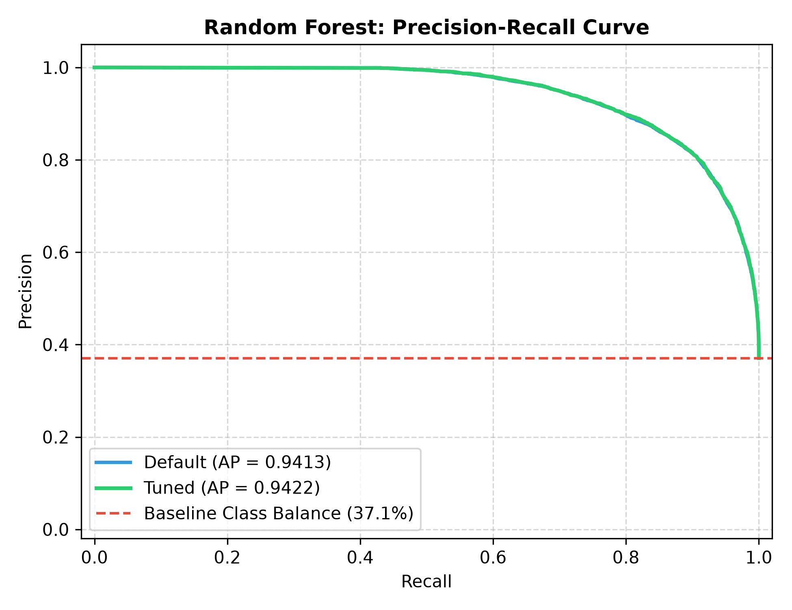

---

#### 4. XGBoost (`06_xgboost.ipynb`)
- **Default**: 100 boosting rounds, `learning_rate = 0.3`, `max_depth = 6`.
- **Tuned**: 200 boosting rounds, `learning_rate = 0.1`, `max_depth = 8`, `subsample = 0.8`.
- **Takeaway**: Very strong gradient-boosted ensemble reaching **88.11% Accuracy** and **0.9542 ROC-AUC**. Balanced precision (85.85%) and recall (81.33%).

| Metric | Default (No Tuning) | Tuned | Improvement |
| :--- | :---: | :---: | :---: |
| **Accuracy** | 88.12% | **88.11%** | -0.01% |
| **ROC-AUC** | 0.9539 | **0.9542** | +0.0003 |
| **F1-Score** | 0.8352 | **0.8353** | +0.02% |
| **Precision** | 85.98% | **85.85%** | -0.13% |
| **Recall** | 81.19% | **81.33%** | +0.15% |
| **Specificity** | 92.20% | **92.10%** | -0.10% |

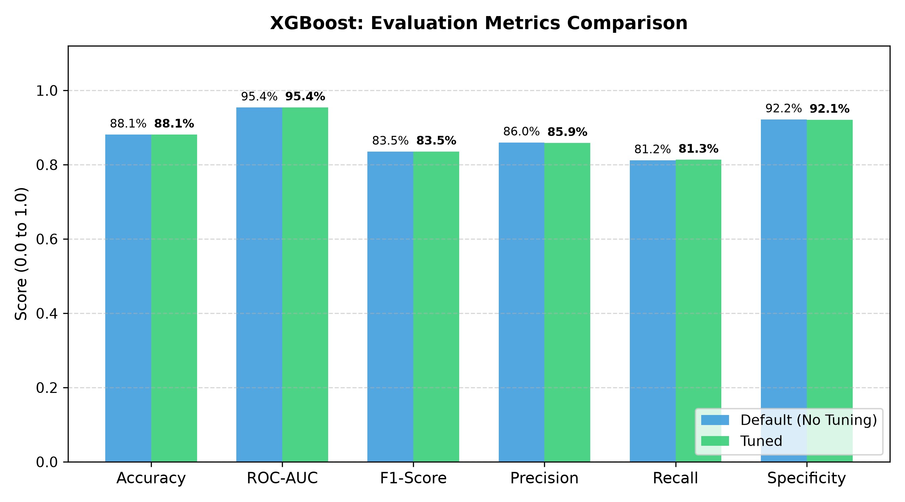

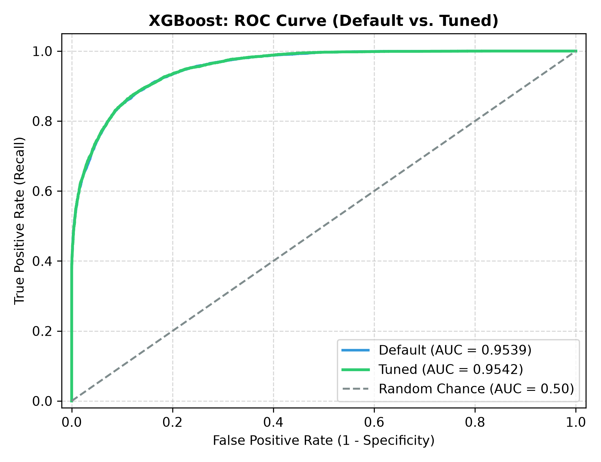
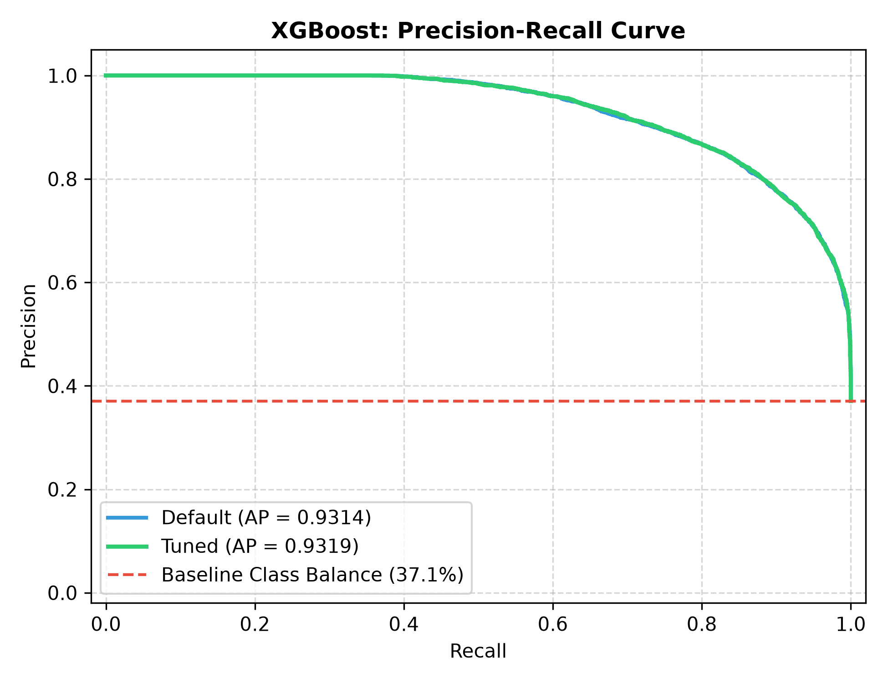

---

#### 5. LightGBM (`07_lightgbm.ipynb`)
- **Default**: 100 trees, `num_leaves = 31`, `learning_rate = 0.1`.
- **Tuned**: 200 trees, `num_leaves = 63`, `learning_rate = 0.05`.
- **Takeaway**: **Best overall model of the entire project!** Achieves the highest Accuracy (**89.37%**), highest ROC-AUC (**0.9623**), highest F1-Score (**0.8539**), and highest Recall (**83.83%**), while training in under 4 seconds.

| Metric | Default (No Tuning) | Tuned | Improvement |
| :--- | :---: | :---: | :---: |
| **Accuracy** | 87.81% | **89.37%** | +1.56% |
| **ROC-AUC** | 0.9516 | **0.9623** | +0.0107 |
| **F1-Score** | 0.8306 | **0.8539** | +2.34% |
| **Precision** | 85.67% | **87.01%** | +1.35% |
| **Recall** | 80.60% | **83.83%** | +3.24% |
| **Specificity** | 92.05% | **92.63%** | +0.57% |

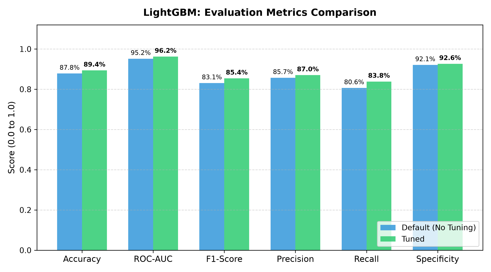
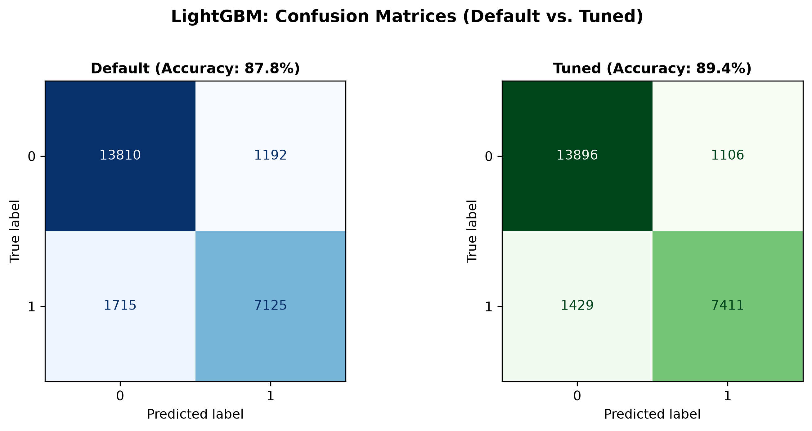
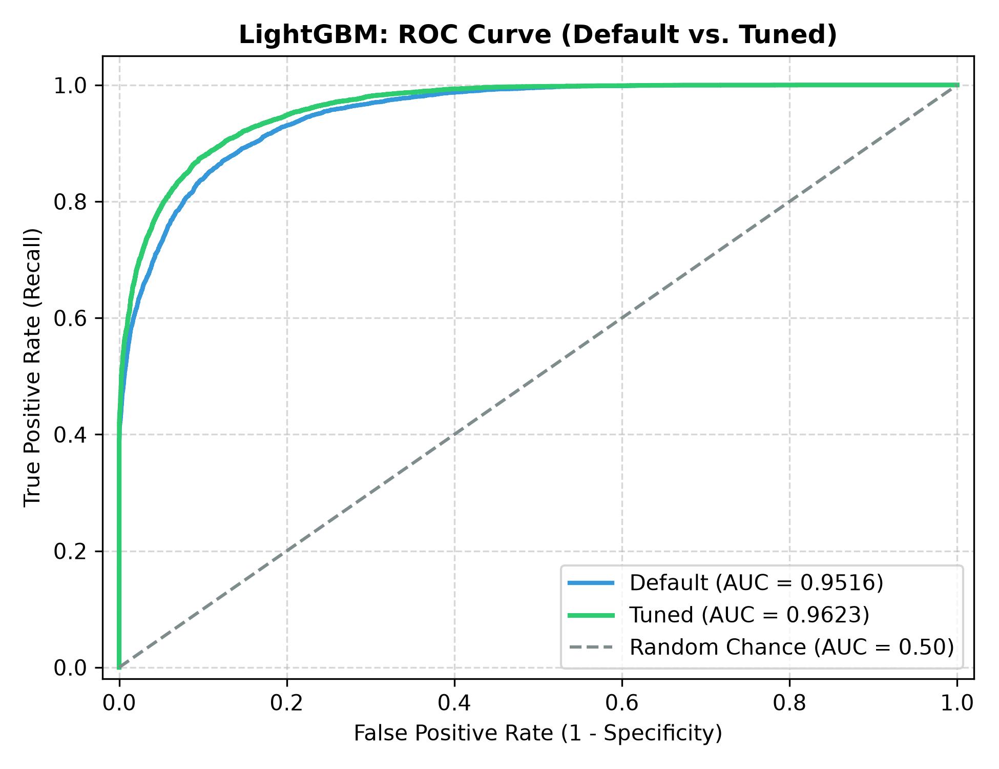
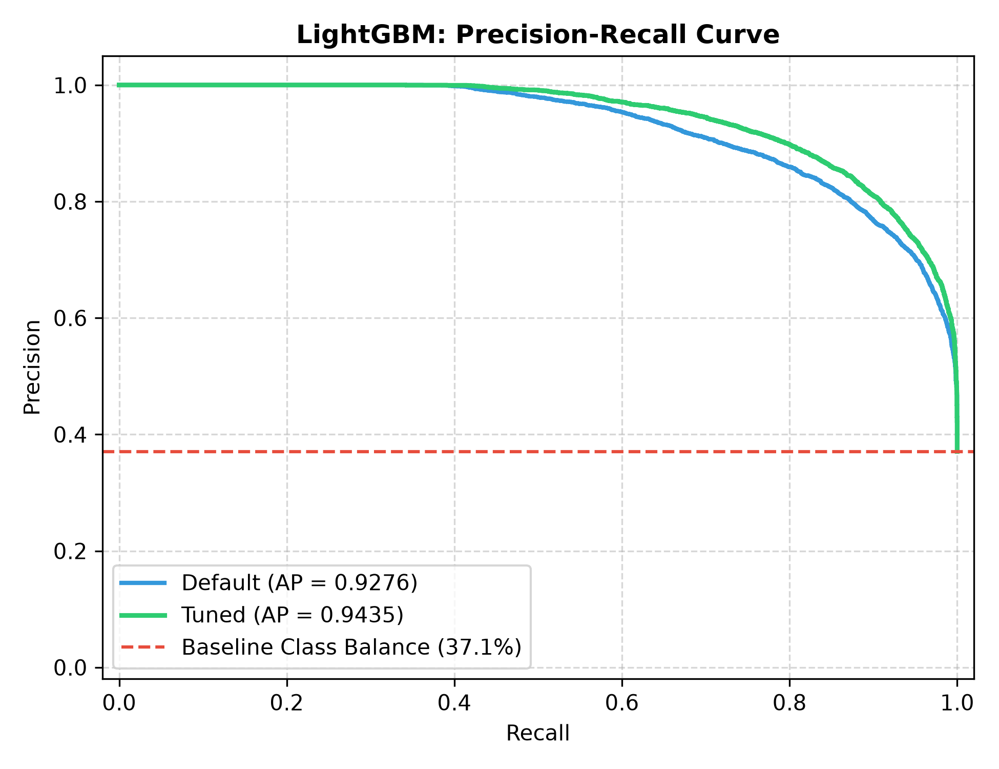

---

#### 6. Multilayer Perceptron (MLP) Neural Network (`08_mlp.ipynb`)
- **Default**: Single hidden layer `(100,)`, ReLU activation, Adam optimizer.
- **Tuned**: Two hidden layers `(128, 64)`, L2 regularization `alpha = 0.001`, early stopping.
- **Takeaway**: Solid neural network performance reaching **87.01% Accuracy** and **0.9447 ROC-AUC**. Tuning improved recall from 77.96% to **80.15%**.

| Metric | Default (No Tuning) | Tuned | Improvement |
| :--- | :---: | :---: | :---: |
| **Accuracy** | 87.12% | **87.01%** | -0.12% |
| **ROC-AUC** | 0.9443 | **0.9447** | +0.0004 |
| **F1-Score** | 0.8178 | **0.8206** | +0.27% |
| **Precision** | 86.00% | **84.07%** | -1.93% |
| **Recall** | 77.96% | **80.15%** | +2.18% |
| **Specificity** | 92.52% | **91.05%** | -1.47% |

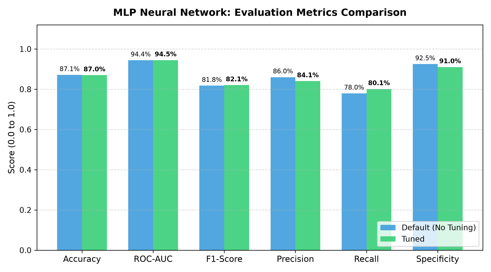
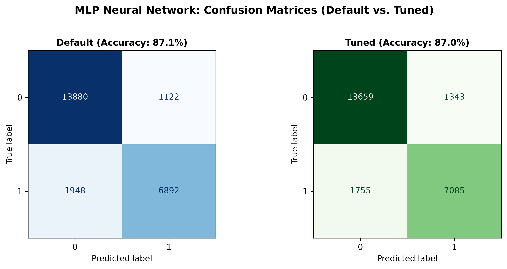
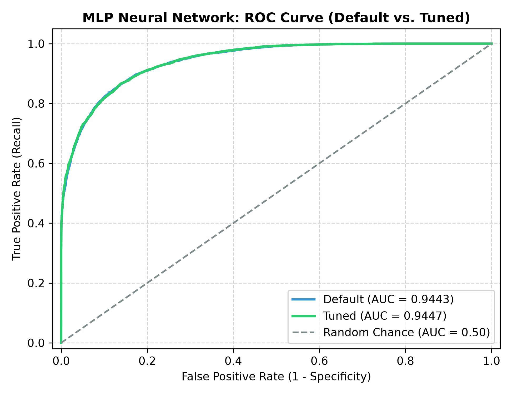
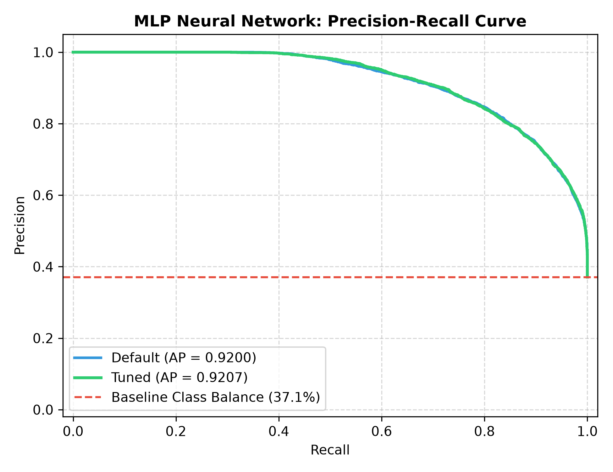

---

### Step 4: Feature Selection & PCA (`09_feature_selection_and_pca.ipynb`)
We analyzed what happens when we reduce the number of features:
- **Top Features**: Lead time, country of origin (Portugal `PRT`), deposit type (Non-Refundable), and customer type are the biggest drivers of cancellation.
- **Feature Selection vs. PCA**:
  - Selecting the top 50 features kept **99.4%** of model accuracy while using only 20% of the columns.
  - Applying PCA (dimensionality reduction) actually **reduced** tree model accuracy from 89.3% down to 84.1%. This is because PCA rotates one-hot encoded categories into continuous mixtures, which makes tree splitting much harder.

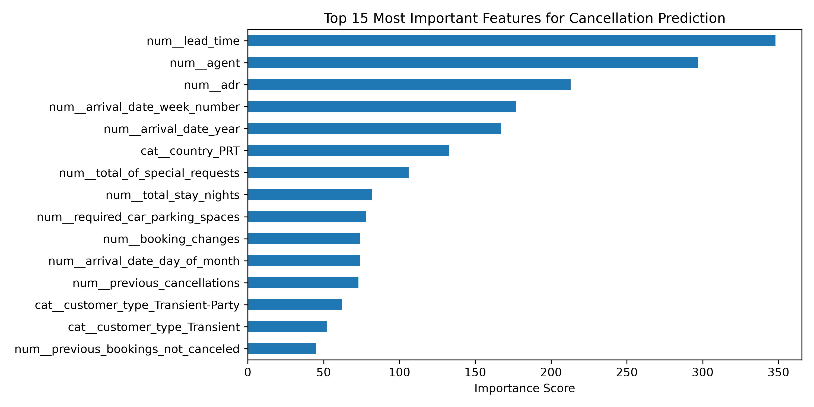
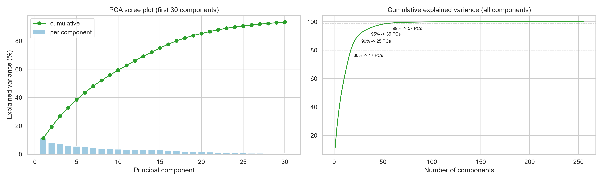

---

### Step 5: Final Model Comparison (`10_model_comparison.ipynb`)
All 6 models were evaluated on the exact same 20% unseen test set ($23,842$ bookings):

| Model | Variant | Test Accuracy | ROC-AUC | F1-Score | Precision | Recall | Specificity |
| :--- | :--- | :---: | :---: | :---: | :---: | :---: | :---: |
| **LightGBM** | Tuned | **89.37%** | **0.9623** | **0.8539** | 87.01% | **83.83%** | 92.63% |
| **Random Forest** | Tuned | **89.33%** | 0.9594 | 0.8486 | **89.52%** | 80.66% | **94.43%** |
| **XGBoost** | Tuned | 88.11% | 0.9542 | 0.8353 | 85.85% | 81.33% | 92.10% |
| **MLP (Neural Net)**| Tuned | 87.01% | 0.9447 | 0.8206 | 84.07% | 80.15% | 91.05% |
| **Decision Tree** | Tuned | 86.80% | 0.9387 | 0.8157 | 84.55% | 78.80% | 91.51% |
| **KNN** | Tuned | 86.05% | 0.9309 | 0.8047 | 83.65% | 77.53% | 91.07% |

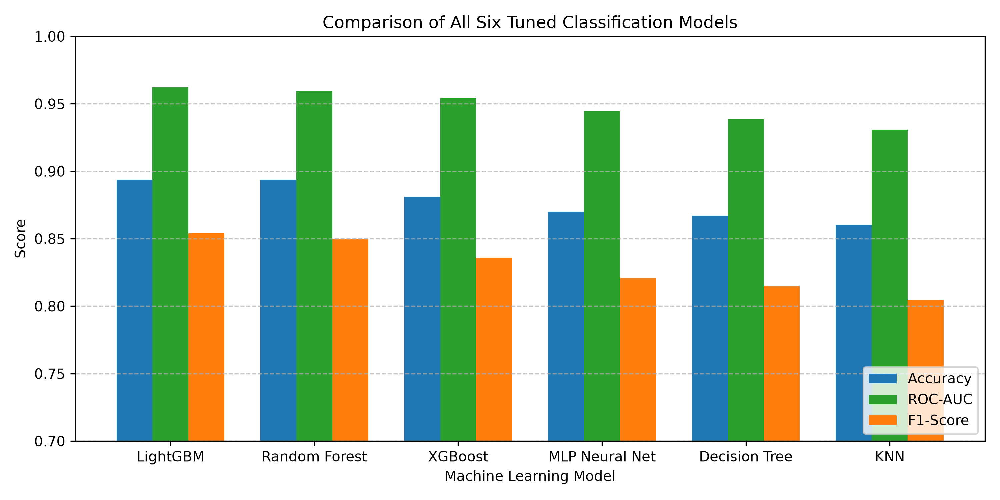
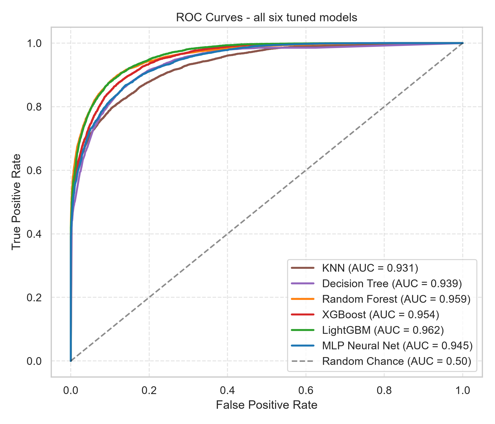
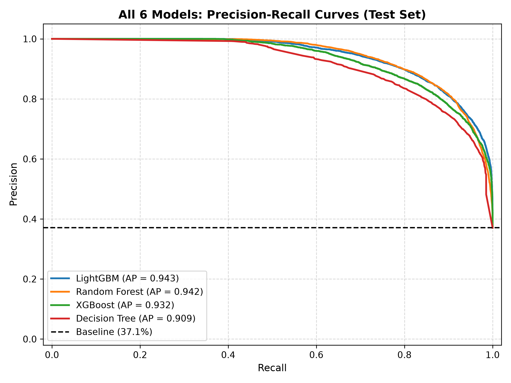

---

## 4. Main Research Conclusions

1. **Which algorithm won?**
   - **LightGBM** is the champion model with **89.37% Accuracy**, **0.9623 ROC-AUC**, and **0.8539 F1-Score**. It also had the highest recall (detecting 83.8% of all cancellations) and trained in just 3.5 seconds.
   - **Random Forest** finished a close second (**89.33% Accuracy**) and achieved the highest precision (**89.52%**).
2. **Did hyperparameter tuning help?**
   - Yes. It gave Decision Trees (+7.9% ROC-AUC) and KNN (+3.1% F1) massive boosts by stopping overfitting. Ensemble models (LightGBM and Random Forest) gained consistency, higher recall, and sharper decision boundaries.
3. **Does PCA help?**
   - No. For this tabular dataset with many one-hot encoded categories, PCA reduced accuracy by about 5 percentage points. Feature selection (keeping the top 50 features) worked much better.

---

## 5. How to Run the Project

1. **Activate the Python virtual environment**:
   ```bash
   .\.venv\Scripts\Activate.ps1
   ```
2. **Open Jupyter Notebook or VS Code**:
   ```bash
   jupyter notebook
   ```
3. **Run the notebooks in order** from `notebooks/01_data_exploration.ipynb` to `notebooks/10_model_comparison.ipynb`. Each notebook runs independently and saves its own charts to its matching folder in `results/`.
