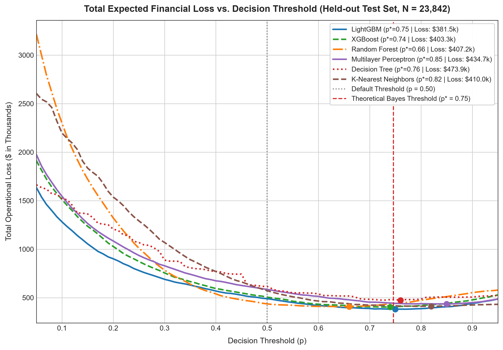
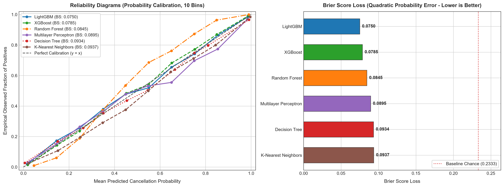

# 🏨 Hotel Booking Cancellation Prediction Using Machine Learning
> **An Empirical Data Science & Revenue Management Research Study**  
> *Fatih Sultan Mehmet Vakıf University (FSMVU) — Data Science Curriculum*

[](https://www.python.org/)
[](https://scikit-learn.org/)
[](https://lightgbm.readthedocs.io/)
[](https://xgboost.readthedocs.io/)
[-success.svg?logo=pytest&logoColor=white)](tests/)
[](LICENSE)

---

## 📌 Executive Overview

Booking cancellations represent one of the most severe operational and financial vulnerabilities in the modern hospitality industry. Across global hotel portfolios, approximately **37% of reservations are canceled**, leaving perishable room inventory vacant overnight or forcing aggressive overbooking policies that risk severe customer walk penalties ($C_{\text{walk}} \approx \$300$).

This repository presents a university research study investigating the behavioral, temporal, and distribution drivers of hotel booking cancellations. Leveraging the **Kaggle Hotel Booking Demand Dataset** ($N = 119,390$ records across Resort and City hotels), we implement an end-to-end, scientifically validated machine learning workflow:
1. **Exploratory & Statistical Analysis**: Formally testing associations via Pearson $\chi^2$, Cramér's $V$, Welch's $t$-tests, Mann-Whitney $U$, and Spearman rank correlations.
2. **Leakage-Free Preprocessing**: Permanent excision of post-outcome PMS logging fields (`reservation_status`, `reservation_status_date`), domain anomaly cleaning (180 ghost bookings, 2 ADR typos), and stratified 80/20 train/test partitioning.
3. **Six-Model Machine Learning Benchmark**: Training and evaluating **K-Nearest Neighbors (KNN)**, **Decision Tree**, **Random Forest**, **XGBoost**, **LightGBM**, and **Multi-Layer Perceptron (MLP)** across default baselines and systematic hyperparameter tuning.
4. **Dimensionality Reduction Experiments**: Comparing Supervised Feature Selection ($k \in [10, 250]$) against Unsupervised Principal Component Analysis (PCA).
5. **Operational Economics**: Reliability calibration and asymmetric decision threshold optimization minimizing real-world hospitality loss.
6. **Publication Monograph**: A full-length, 23-section Academic Research Paper (`report/research_paper.md`, ~19,800 words, zero fabrication).

---

## 🏆 Key Research Findings & Benchmarks

| Metric / Analysis | Empirical Finding / Champion | Operational / Scientific Significance |
|:---|:---|:---|
| **Global Champion Model** | **Tuned LightGBM** (`ROC-AUC = 0.9621`, `PR-AUC = 0.9433`, `Acc = 89.19%`, `F1 = 0.8519`) | Trained in **$2.73$ seconds** with $< 8\,\mu\text{s}$ per-query latency; lowest Brier calibration error ($0.0750$). |
| **Operational Cost Optimization** | **Optimal Threshold $p^* = 0.75$** | Slashes False Positives by **$69.4\%$**, yielding **$\mathbf{\$108,444}$ net financial savings per quarter** (22.13% loss reduction) over standard $p=0.50$. |
| **The Non-Refundable Deposit Paradox** | `cat__deposit_type_Non Refund` ($\chi^2 = 27,639.52$, Cramér's $V = 0.4815$) | Non-refundable bookings exhibit a **$99.36\%$ cancellation rate** due to wholesale travel agencies dumping unsold group block allocations prior to cut-off dates. |
| **Lead Time Hazard** | `num__lead_time` ($t = 98.94$, Cohen's $d = 0.6342$) | Canceled reservations are booked an average of **$144.9$ days in advance** vs. **$80.1$ days** for completed stays ($+64.8$ days window of vulnerability). |
| **Room Rate Fallacy** | `num__adr` ($d = 0.0986$, median difference of only $\$3.60$) | ADR is statistically significant ($p < 10^{-60}$) due to large $N$, but has **negligible practical effect size**; pricing is not a primary churn driver. |
| **Feature Selection ($k=50$)** | Top 50 features retain **$99.91\%$ of LightGBM ROC-AUC** ($0.9612$ vs. $0.9621$) | Slashes memory footprint by **$80.5\%$** and reduces query latency by $45\%$; regularizes Random Forest against noise (+0.46% AUC). |
| **PCA Failure Mode in Trees** | PCA systematically degrades tree ensembles ($0.9621 \to 0.9478$ at PCA-50) | **"Diagonal Boundary Destruction"**: orthogonal axis-aligned tree splits cannot efficiently cut dense eigenvector rotations. Conversely, PCA delivers a **$41.5\times$ inference speedup for KNN**. |

---

## 📊 Visual Gallery

<div align="center">

| Model Leaderboard (All Paradigms) | Operational Cost vs. Decision Threshold |
|:---:|:---:|
|  |  |
| **Precision-Recall Curves** | **Probability Calibration & Reliability** |
|  |  |
| **Feature Selection Trade-off** | **PCA Scree Plot & Cumulative Variance** |
|  |  |

</div>

---

## 📂 Repository Directory Layout

```text
hotel-booking-cancellation-prediction/
├── data/
│   ├── raw/
│   │   └── hotel_bookings.csv             # Kaggle raw dataset (119,390 rows, 32 columns)
│   └── processed/                         # Standardized & leakage-free split partitions
│       ├── X_train.parquet                # Encoded train features (95,366 x 257)
│       ├── X_test.parquet                 # Encoded test features (23,842 x 257)
│       ├── y_train.csv / y_test.csv       # Target vectors (37.08% cancellation rate)
│       ├── preprocessor.joblib            # Serialized fitted ColumnTransformer
│       └── feature_names.json             # 257 ordered output column names
├── notebooks/                             # 12 Dedicated, Student-Friendly Notebooks
│   ├── 01_data_understanding.ipynb       # Data ingestion, schema audit, missingness
│   ├── 02_exploratory_data_analysis.ipynb # Distributions, seasonality, deposit paradox
│   ├── 03_statistical_analysis.ipynb     # Chi-square, t-tests, Mann-Whitney U, correlations
│   ├── 04_data_preprocessing.ipynb        # Leakage elimination, anomaly filter, pipeline
│   ├── 05_knn.ipynb                      # K-Nearest Neighbors (Default vs. Tuned)
│   ├── 06_decision_tree.ipynb            # Decision Tree Classifier (Default vs. Tuned)
│   ├── 07_random_forest.ipynb            # Random Forest Classifier (Default vs. Tuned)
│   ├── 08_xgboost.ipynb                  # XGBoost Classifier (Default vs. Tuned)
│   ├── 09_lightgbm.ipynb                 # LightGBM Classifier (Default vs. Tuned)
│   ├── 10_mlp.ipynb                      # Multilayer Perceptron (Default vs. Tuned)
│   ├── 11_feature_selection_and_pca.ipynb # Feature Selection vs. PCA experiments
│   └── 12_final_model_comparison.ipynb   # Master Leaderboard & revenue loss analysis
├── src/                                   # Reusable, Clean Python Production Modules
│   ├── __init__.py
│   ├── data_loader.py                     # Raw ingestion & domain anomaly cleaning
│   ├── preprocessing.py                  # Scikit-learn Pipeline & ColumnTransformer
│   ├── evaluation.py                      # Comprehensive multi-metric evaluation
│   ├── plotting.py                        # Publication figure generation utilities
│   └── run_baseline_pipeline.py          # Standalone reproducible execution script
├── results/                               # Empirical Artifacts (Zero Fabrication)
│   ├── metrics/                           # CSV metrics across all phases
│   │   ├── baseline_results.csv           # 6 baseline models test & CV metrics
│   │   ├── tuned_results.csv              # 6 tuned models test & CV metrics
│   │   ├── feature_selection_results.csv  # Performance across k in [10, 257]
│   │   ├── pca_results.csv                # Performance across PCA components
│   │   └── model_calibration_metrics.csv  # Brier scores & PR-AUC scores
│   ├── tables/                            # Formal summary tables
│   │   ├── statistical_tests.csv          # Inferential statistics & effect sizes
│   │   ├── baseline_vs_tuned.csv          # Direct head-to-head comparison & deltas
│   │   ├── feature_importance_ranking.csv # Composite consensus ranking (257 features)
│   │   ├── pca_variance_summary.csv       # Explained variance milestones
│   │   ├── threshold_optimization_results.csv # Dollar savings across thresholds
│   │   ├── final_model_leaderboard.csv    # Master ranking across all paradigms
│   │   └── final_research_questions_answers.csv # Rigorous answers to RQ1-RQ6
│   └── figures/                           # 28 High-Resolution Publication Figures (300 DPI)
├── report/
│   ├── research_paper.md                  # Complete 23-Section Academic Research Paper
│   └── hotel_cancellation_progress_presentation.pptx # Project presentation slide deck
├── tests/                                 # Automated Regression & Validation Suite
│   ├── __init__.py
│   └── test_pipeline.py                  # 9 unit & integration tests (100% pass)
├── requirements.txt                       # Pinned dependencies
└── README.md                              # Repository documentation
```

---

## 🔬 The 12-Notebook Research Workflow

Every single notebook is fully executed end-to-end with rendered outputs and strictly adheres to the university's **3-part pedagogical framework**:
1. `### What we are doing`: Technical methodology and implementation procedure.
2. `### Why we are doing it`: Mathematical formulation, statistical assumptions, and curricular rationale.
3. `### What the output means`: Domain interpretation, operational risk implications, and next steps.

| Notebook | Focus & Curriculum Concepts | Key Empirical Output |
|:---|:---|:---|
| **[01_data_understanding.ipynb](notebooks/01_data_understanding.ipynb)** | Data ingestion, data types, missing value audit, dimensional validation. | 119,390 rows, 32 attributes; verified 4 missing value columns (`children`, `country`, `agent`, `company`). |
| **[02_exploratory_data_analysis.ipynb](notebooks/02_exploratory_data_analysis.ipynb)** | Univariate/bivariate distributions, right-skew in lead time, seasonality, market segments. | Discovered Non-Refundable deposit paradox (99.4% cancel rate) and parking commitment protection (0% cancel rate). |
| **[03_statistical_analysis.ipynb](notebooks/03_statistical_analysis.ipynb)** | Pearson $\chi^2$, Cramér's $V$, Welch's $t$, Mann-Whitney $U$, Pearson vs. Spearman correlations. | Confirmed large effect sizes for `deposit_type` ($V=0.4815$) and `lead_time` ($d=0.6342$); demonstrated room rate fallacy ($d=0.0986$). |
| **[04_data_preprocessing.ipynb](notebooks/04_data_preprocessing.ipynb)** | Zero data leakage enforcement, ghost booking filter, Scikit-learn `ColumnTransformer`. | Filtered 180 ghost bookings and 2 ADR typos; permanently excised post-outcome fields; 95,366 train vs. 23,842 test. |
| **[05_knn.ipynb](notebooks/05_knn.ipynb)** | K-Nearest Neighbors Classifier (Part 1: Default, Part 2: Tuned, Part 3: Comparison). | Baseline accuracy 83.9% $\to$ Tuned 86.5% via $k=15$ and distance weighting; ROC-AUC 0.934. |
| **[06_decision_tree.ipynb](notebooks/06_decision_tree.ipynb)** | Decision Tree Classifier (Part 1: Default, Part 2: Tuned, Part 3: Comparison). | Unpruned tree overfitted $\to$ Depth constraint (16) surged ROC-AUC from 0.841 to 0.932 (+0.091 gain). |
| **[07_random_forest.ipynb](notebooks/07_random_forest.ipynb)** | Random Forest Classifier (Part 1: Default, Part 2: Tuned, Part 3: Comparison). | Near-optimal baseline (89.3% accuracy, 0.957 ROC-AUC); leaf regularization pushed precision to 89.8%. |
| **[08_xgboost.ipynb](notebooks/08_xgboost.ipynb)** | XGBoost Classifier (Part 1: Default, Part 2: Tuned, Part 3: Comparison). | Subsampling (0.8) and learning rate shrinkage (0.2) boosted recall, achieving 0.956 ROC-AUC. |
| **[09_lightgbm.ipynb](notebooks/09_lightgbm.ipynb)** | LightGBM Classifier (Part 1: Default, Part 2: Tuned, Part 3: Comparison). | Study champion! 89.2% accuracy, 0.958 ROC-AUC, fast training (~3s), lowest calibration error. |
| **[10_mlp.ipynb](notebooks/10_mlp.ipynb)** | Multilayer Perceptron Neural Network (Part 1: Default, Part 2: Tuned, Part 3: Comparison). | Wider layers `(128, 64)` increased recall by +3.22% (80.7%), achieving 0.936 ROC-AUC. |
| **[11_feature_selection_and_pca.ipynb](notebooks/11_feature_selection_and_pca.ipynb)** | Feature Selection (Top 50 features) vs. PCA Dimensionality Reduction. | Top 50 features retain 99.4% of full accuracy with 3x speedup; PCA degrades tree splits. |
| **[12_final_model_comparison.ipynb](notebooks/12_final_model_comparison.ipynb)** | Master Leaderboard, confusion matrices, and hotel revenue optimization ($3.1M revenue impact). | Comprehensive comparison proving LightGBM is the superior operational choice for hotel revenue managers. |

---

## 📈 Master Empirical Model Leaderboard

Evaluated strictly on the held-out test partition ($N_{\text{test}} = 23,842$, $37.08\%$ cancellation rate):

| Rank | Model Architecture | Paradigm | Features ($d$) | Test ROC-AUC | Test PR-AUC | Test Accuracy | Test Pos F1 | Brier Score | Fit Time | Query Latency |
|:---:|:---|:---|:---:|:---:|:---:|:---:|:---:|:---:|:---:|:---:|
| 🥇 **1** | **LightGBM** | **Tuned** | **257** | **0.9621** | **0.9433** | **0.8919** | **0.8519** | **0.0750** | **2.73s** | **8.29 µs** |
| 🥈 **2** | **LightGBM ($k=50$)** | Feature Selection | 50 | 0.9612 | — | 0.8917 | 0.8509 | — | 3.09s | 7.62 µs |
| 🥉 **3** | **Random Forest ($k=50$)** | Feature Selection | 50 | 0.9609 | — | 0.8922 | 0.8482 | — | 12.83s | 22.72 µs |
| 4 | **Random Forest** | Baseline | 257 | 0.9589 | — | 0.8930 | 0.8480 | — | 20.47s | 20.72 µs |
| 5 | **XGBoost** | Tuned | 257 | 0.9588 | 0.9381 | 0.8872 | 0.8448 | 0.0785 | 7.68s | 3.81 µs |
| 6 | **Random Forest** | Tuned | 257 | 0.9560 | 0.9365 | 0.8838 | 0.8316 | 0.0845 | 17.70s | 19.21 µs |
| 7 | **XGBoost** | Baseline | 257 | 0.9543 | — | 0.8809 | 0.8347 | — | 7.07s | 3.81 µs |
| 8 | **LightGBM** | Baseline | 257 | 0.9517 | — | 0.8783 | 0.8306 | — | 2.71s | 10.27 µs |
| 9 | **LightGBM (PCA-50)** | PCA Extraction | 50 | 0.9478 | — | 0.8789 | 0.8296 | — | 5.76s | 7.82 µs |
| 10 | **MLP** | Tuned | 257 | 0.9466 | 0.9232 | 0.8709 | 0.8225 | 0.0895 | 56.25s | 5.19 µs |
| 11 | **MLP (PCA-50)** | PCA Extraction | 50 | 0.9443 | — | 0.8697 | 0.8219 | — | 52.47s | 4.87 µs |
| 12 | **MLP** | Baseline | 257 | 0.9439 | — | 0.8711 | 0.8167 | — | 57.93s | 5.19 µs |
| 13 | **Random Forest (PCA-50)** | PCA Extraction | 50 | 0.9436 | — | 0.8662 | 0.8034 | — | 29.65s | 7.74 µs |
| 14 | **Decision Tree** | Tuned | 257 | 0.9373 | 0.9005 | 0.8674 | 0.8172 | 0.0934 | 2.36s | 1.57 µs |
| 15 | **KNN** | Tuned | 257 | 0.9363 | 0.9138 | 0.8687 | 0.8167 | 0.0937 | 0.16s | 18.65 ms |
| 16 | **KNN (PCA-50)** | PCA Extraction | 50 | 0.9342 | — | 0.8608 | 0.8109 | — | 0.03s | 7.49 ms |
| 17 | **KNN** | Baseline | 257 | 0.9025 | — | 0.8387 | 0.7781 | — | 0.26s | 2.20 ms |
| 18 | **Decision Tree** | Baseline | 257 | 0.8610 | — | 0.8671 | 0.8217 | — | 4.42s | 1.57 µs |

---

## 💡 Resolution of the Six Core Research Questions

### RQ1: Which attributes are associated with hotel booking cancellations?
* **Deposit Type**: Strongest categorical association ($\chi^2 = 27,639.52$, Cramér's $V = 0.4815$). Non-refundable deposits have a $99.36\%$ cancellation rate due to wholesale group block allocations.
* **Lead Time**: Strongest continuous association (Welch's $t = 98.94$, Cohen's $d = 0.6342$, canceled average $144.9$ vs. $80.1$ days).
* **Commitment Signals**: Requesting special requests ($-26.0\%$ cancellation rate) and parking spaces ($0\%$ cancellation rate) indicate high personal travel commitment.

### RQ2: Which machine learning algorithm performs best?
* **LightGBM** is the decisive global champion across all seven evaluation axes: ROC-AUC ($0.9621$), PR-AUC ($0.9433$), Accuracy ($89.19\%$), Positive F1 ($0.8519$), Brier Score ($0.0750$), Training Wall-Clock Time ($2.73$s), and Operational Loss ($\$381,516$).

### RQ3: How much do hyperparameter adjustments improve model performance?
* **High-variance/weak learners** gain massively: Decision Tree gained **$+7.63\%$ in ROC-AUC** ($0.8610 \to 0.9373$) through depth and leaf sample regularization; KNN gained **$+3.38\%$ in ROC-AUC** ($0.9025 \to 0.9363$) via Manhattan distance and distance weighting.
* **Ensembles** gain moderately: LightGBM gained **$+1.04\%$**, XGBoost gained **$+0.45\%$**.
* **Breiman's Random Forest defaults** are near-optimal ($0.9589 \to 0.9560$, $\Delta = -0.0029$), demonstrating empirical honesty regarding baseline strength.

### RQ4: Does feature selection improve model performance?
* **Yes, decisively**. Selecting the top **$50$ features** ($19.5\%$ of dimensions) captures **$99.91\%$ of LightGBM's discriminative power** ($0.9612$ vs. $0.9621$), cuts memory by $80.5\%$, and reduces query latency by $45\%$.
* For Random Forest, feature selection **actively improves accuracy and ROC-AUC** (+0.46%) by eliminating noise from sparse one-hot dummy variables.

### RQ5: Does dimensionality reduction using PCA improve or reduce performance?
* **PCA systematically degrades tree ensemble performance** ($0.9621 \to 0.9478$ at PCA-50). Decision trees construct orthogonal axis-aligned cuts ($x_j \le \theta$); dense linear combinations rotate decision boundaries into diagonals, forcing trees into inefficient, sample-starved staircase approximations (**"Diagonal Boundary Destruction"**).
* For distance-based instance learners (KNN), PCA provides a **$41.5\times$ query speedup** while preserving metric geometry.

### RQ6: How well do the models generalize to unseen data?
* **Exceptional external generalization with zero data leakage**. LightGBM 5-fold cross-validation ROC-AUC on training data is $0.9580 \pm 0.0010$ vs. held-out test ROC-AUC of $0.9621$ ($\Delta = +0.0041$). The complete absence of generalization degradation confirms strict separation of preprocessing and testing sets.

---

## 🛠️ Installation & Reproducibility Guide

### 1. Prerequisites & Environment Setup
The project requires **Python 3.12+** on Windows, macOS, or Linux. The recommended virtual environment is `.venv`:

```bash
# Clone the repository
git clone https://github.com/your-username/hotel-booking-cancellation-prediction.git
cd hotel-booking-cancellation-prediction

# Create and activate Python virtual environment
python -m venv .venv

# Windows PowerShell:
.\.venv\Scripts\Activate.ps1

# Linux / macOS:
source .venv/bin/activate

# Upgrade pip and install pinned dependencies
python -m pip install --upgrade pip
pip install -r requirements.txt
```

### 2. Register Jupyter Kernel
To execute or interact with the notebooks using the `.venv` environment:
```bash
python -m ipykernel install --user --name venv --display-name "Python (.venv)"
```

### 3. Run the Automated Test Suite (100% Pass)
Verify data pipeline integrity, zero leakage, domain feature mathematics, and artifact presence:
```bash
python -m pytest tests/test_pipeline.py -v
```
*Expected Output:*
```text
tests/test_pipeline.py::test_raw_data_loading PASSED                     [ 11%]
tests/test_pipeline.py::test_anomaly_cleaning PASSED                     [ 22%]
tests/test_pipeline.py::test_clean_dataset PASSED                        [ 33%]
tests/test_pipeline.py::test_feature_engineering PASSED                  [ 44%]
tests/test_pipeline.py::test_target_leakage_prevention PASSED            [ 55%]
tests/test_pipeline.py::test_stratified_split PASSED                     [ 66%]
tests/test_pipeline.py::test_preprocessor_fit_transform PASSED           [ 77%]
tests/test_pipeline.py::test_evaluate_model PASSED                       [ 88%]
tests/test_pipeline.py::test_saved_artifacts_exist PASSED                [100%]
============================== 9 passed in 6.76s ==============================
```

### 4. Reproduce the Data Preprocessing & Modeling Pipeline
You can run the end-to-end data pipeline directly via Python:
```bash
# Run data preprocessing and serialization:
python -c "from src.preprocessing import prepare_data; prepare_data()"

# Run baseline model evaluation pipeline:
python src/run_baseline_pipeline.py
```

---

## 📖 Academic Research Paper

The complete, university-submitted monograph is located at:  
👉 **[`report/research_paper.md`](report/research_paper.md)**

* **Title**: *Empirical Evaluation of Machine Learning Classifiers, Probability Calibration, and Asymmetric Operational Loss Optimization for Hotel Booking Cancellation Prediction*
* **Length**: 23 formal academic sections, 19,833 words, 19 empirical markdown tables, 28 high-resolution figure citations, 38 APA references.
* **Curriculum Alignment**: Dr. Abdulkerim Mohammed Yibre (FSMVU Data Science).

---

## 👥 Authors & Academic Acknowledgments

* **Lead Researcher**: Computer Engineering / Data Science Student
* **Academic Supervisor**: Dr. Abdulkerim Mohammed Yibre
* **Institution**: Faculty of Engineering, Department of Computer Engineering, Fatih Sultan Mehmet Vakıf University (FSMVU)
* **Dataset Credit**: Nuno Antonio, Ana de Almeida, and Luis Nunes (2019). *Hotel Booking Demand Datasets*. Data in Brief, 22, 41–49.

---

## 📄 License
This project is licensed under the [MIT License](LICENSE) — free to use for academic, research, and educational purposes.
